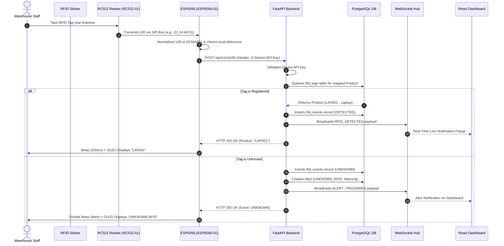
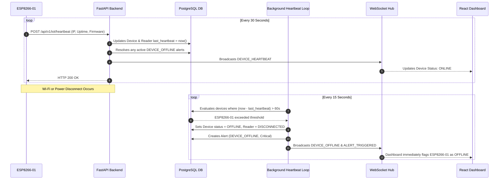

# Smart Rack IoT Inventory System - Architecture Specification

## 1. System Overview

The **IoT Smart Rack Inventory Management System** bridges physical warehouse storage racks with enterprise web applications via an ESP8266 Wi-Fi micro-controller and an RC522 13.56 MHz high-frequency RFID reader.

```text
[ Physical RFID Tag on Item ]
             │
             ▼ (13.56 MHz SPI)
[ RC522 RFID Reader (RC522-01) ]
             │
             ▼ (SPI Bus: D5/D6/D7/D8)
[ ESP8266 NodeMCU (ESP8266-01) ]  <── Optional: SSD1306 OLED (I2C) & Active Buzzer
             │
             ▼ (Wi-Fi 802.11 b/g/n / REST API with X-Device-API-Key)
[ FastAPI Backend (/api/v1/iot/rfid & /api/v1/iot/heartbeat) ]
             │
    ┌────────┴──────────────────────────┐
    ▼                                   ▼
[ PostgreSQL Database ]       [ WebSocket Hub / SSE ]
 (Atomic Transactions,         (Real-time event broadcast:
  RFID mapping, Audits,         RFID scans, Alerts, Devices)
  Products, Devices, Alerts)            │
                                        ▼
                           [ React + TypeScript Web App ]
                           - Live Warehouse Dashboard
                           - Product Catalog & RFID Assignment
                           - Atomic Inventory Operations
                           - Rack A1 Visualization
                           - Transaction Audit History
                           - Real Analytics & Demand Forecast
                           - Device & Heartbeat Monitor
                           - Development Simulator (Demarcated)
```

---

## 2. Hardware Topology & Hierarchy

The physical deployment is structured as a hierarchical topology:

```text
Rack A1 (Primary Storage Bay)
   │
   └── RC522-01 (13.56 MHz SPI Reader)
          │
          └── ESP8266-01 (NodeMCU Wi-Fi Gateway)
```

The database schema and API endpoints are natively architected to scale horizontally to additional physical racks in the future (`Rack A2 -> RC522-02 -> ESP8266-02`, etc.) without schema alterations.

---

## 3. Core Business Principles

### A. RFID Detection vs. Inventory Transaction (Rule 7, 8, 27)
- **RFID Detection**: Represents the physical proximity event: *"Tag `E234A891` was detected by Reader RC522-01 on Rack A1."*
- **Inventory Transaction**: Represents an authorized stock alteration (*"Operator received +5 units of Laptop LAP001 on Rack A1"*).
- **Critical Rule**: Merely scanning or resting an RFID tag on the reader **never** blindly modifies inventory quantity. This prevents runaway duplicate counts.

### B. Hardware Debounce & Duplicate Suppression
- The backend maintains an in-memory sliding debounce cache (`settings.RFID_DEBOUNCE_SECONDS = 3.0s`).
- Scans matching `(device_id, reader_id, uid)` within the debounce window are recorded once and subsequent duplicate triggers are suppressed.

### C. Atomic Inventory Consistency
- Every stock modification is wrapped in an atomic database transaction.
- Prevented negative quantities: An attempt to dispatch or remove more stock than is currently physically on-hand immediately raises a `400 Bad Request` rollback.
- Stock changes create an immutable `inventory_transactions` record for complete auditing.

---

## 4. Sequence Diagrams

### A. Real-Time RFID Tag Scan Flow



### B. Device Heartbeat & Offline Watchdog Flow


